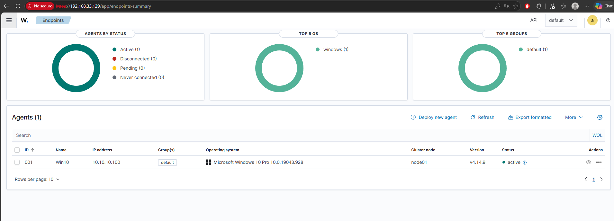
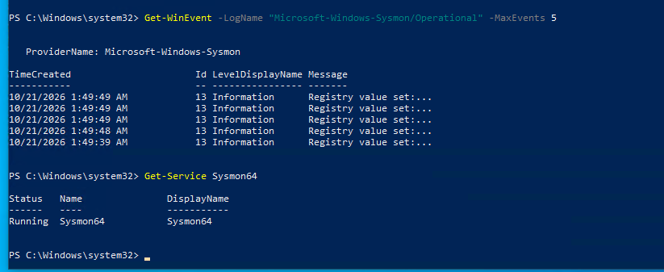
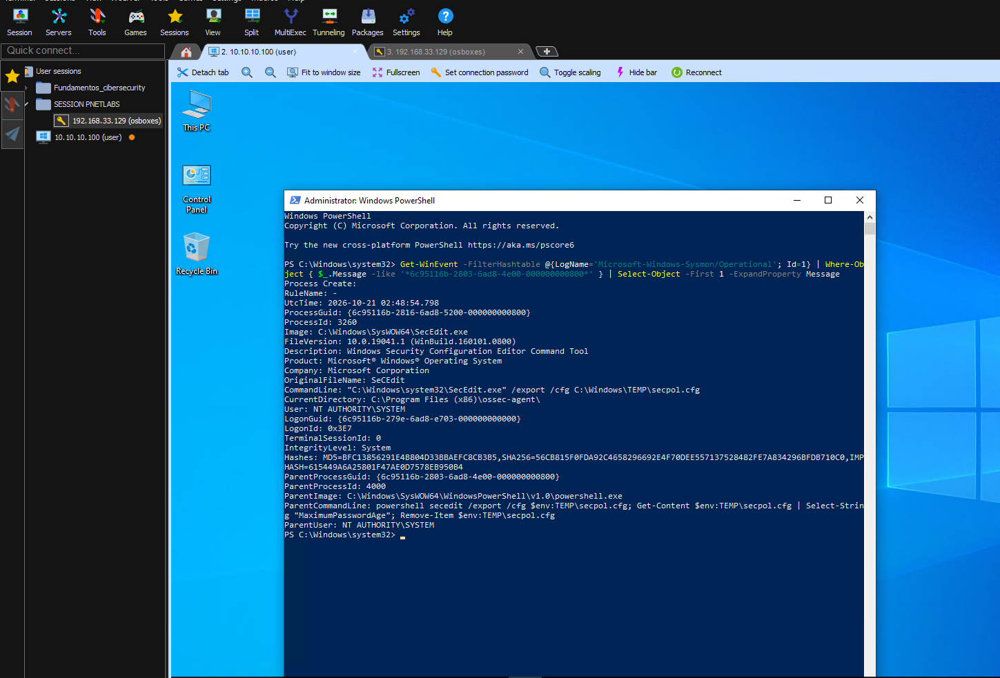

# Wazuh and Windows Monitoring

## 1. Objective

Deploy endpoint telemetry on a Windows 10 host, validate that logs reach
the Wazuh SIEM, and practice separating benign activity from real threats
through alert investigation and process pivoting.

## 2. Environment

- **SIEM:** Wazuh 4.14 (Ubuntu Server 22.04, 10.10.30.10)
- **Endpoint:** Windows 10 Pro (10.10.10.100)
- **Telemetry:** Sysmon (SwiftOnSecurity configuration) + Wazuh agent
- **Virtualization:** PNETLab over VMware

## 3. Scenario

A SIEM is only useful if endpoints actually send rich telemetry. Default
Windows logging is limited, so Sysmon is added to capture process
creation, network connections, file creation, and registry changes. The
Wazuh agent forwards both the Windows Event Log and the Sysmon channel to
the manager.

Once telemetry flows, the analyst must be able to read an alert and decide
whether it is a real threat or benign activity — a core L1 skill.

## 4. Methodology

1. Install Sysmon with a tuned configuration on Windows 10.
2. Deploy the Wazuh agent and confirm it registers as active.
3. Configure the agent group to forward the Sysmon channel.
4. Generate activity and locate the events in Threat Hunting.
5. Investigate alerts and classify them (benign vs. suspicious).

## 5. Key tasks performed

- **Sysmon deployment:** installed Sysmon64 with the SwiftOnSecurity
  config, confirmed the service was running and generating events
  (IDs 1, 3, 11, 13, 22).
- **Agent enrollment:** deployed the Wazuh MSI agent, confirmed status
  `active` in the dashboard (agent 001, Windows 10 Pro).
- **Centralized config:** edited the `default` group's `agent.conf` to
  forward the `Microsoft-Windows-Sysmon/Operational` channel.
- **Log validation:** confirmed Sysmon events arriving in Threat Hunting,
  mapped to MITRE ATT&CK.

## 6. Investigation example — false-positive analysis

An alert fired: **rule 92201 (PowerShell created a script in Windows
Temp, level 9)**, running as `NT AUTHORITY\SYSTEM`. On its own this looks
suspicious (SYSTEM-level PowerShell writing scripts).

**Investigation:** by pivoting on the Sysmon `ProcessGuid`, the child
process was traced to `secedit /export`, executed from
`C:\Program Files (x86)\ossec-agent\`. This revealed the activity was the
**Wazuh agent's own Configuration Assessment (SCA) module** checking the
system's password policy — not an attacker.

**Conclusion:** False positive. Recommended tuning to exclude this
pattern.

**Takeaway:** the same command (`secedit /export`) could be malicious in
another context (MITRE T1201 — Password Policy Discovery). What made it
benign was not the command, but the **context**: who launched it and from
where. Classifying by context, not by the command alone, is the key skill.

## 7. Findings

- Telemetry pipeline (Sysmon → agent → manager → dashboard) working
  end to end.
- A SIEM does not decide what is an attack; the analyst does. An
  administrator's normal activity (downloading tools, enumerating users)
  looks identical to an attacker's — context is everything.
- A SIEM only stores events that match a rule; some raw events must be
  retrieved directly from the endpoint when no rule captured them.

## 8. Lessons Learned

- Pivoting on a unique identifier (ProcessGuid) is how you connect
  separate events into one story.
- Not every high-severity alert is a real incident — and not every real
  incident is high severity.

## 9. References

- Wazuh documentation — https://documentation.wazuh.com/
- Sysmon (Sysinternals) — https://learn.microsoft.com/sysinternals/downloads/sysmon
- SwiftOnSecurity Sysmon config — https://github.com/SwiftOnSecurity/sysmon-config
