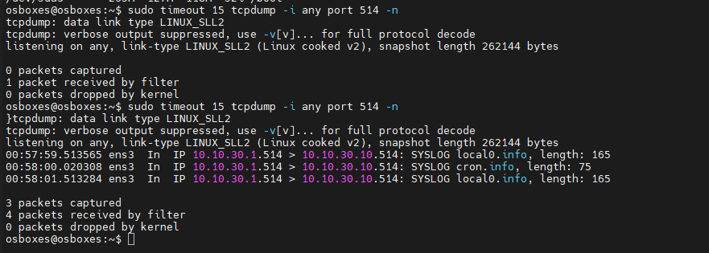
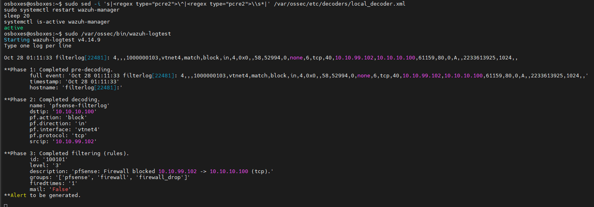
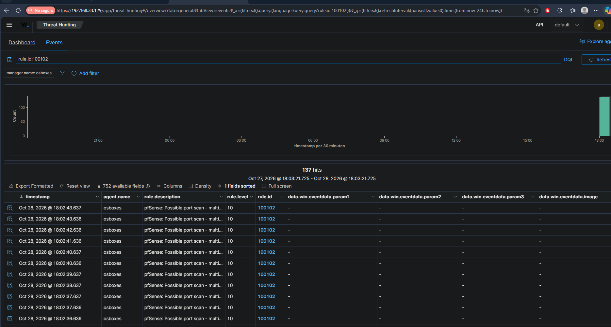
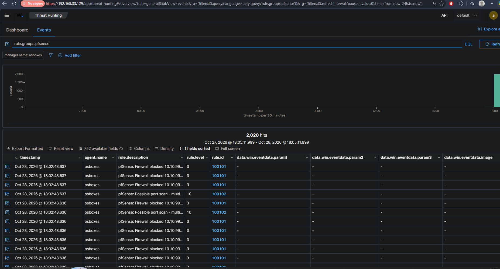

# Firewall and Network Analysis

## 1. Objective

Forward pfSense firewall logs to the Wazuh SIEM, and detect a network
port scan at the firewall level — building network visibility on top of
endpoint detection. When the default ruleset did not parse the firewall
logs, a custom decoder and rules were written to generate alerts.

This project demonstrates log forwarding, root-cause troubleshooting, and
custom detection engineering (decoders and correlation rules).

## 2. Environment

- **Firewall:** pfSense 2.7 (segmented: LAN, DMZ, SOC, ATK)
- **SIEM:** Wazuh 4.14 (Ubuntu Server 22.04, 10.10.30.10)
- **Attacker:** Kali Linux (10.10.99.102)
- **Virtualization:** PNETLab over VMware

## 3. Scenario

Endpoint telemetry shows what happens *on* a host, but the firewall sees
what crosses the *network*. A port scan is often barely visible on the
target endpoint yet fully visible at the firewall. The goal is to forward
pfSense logs to Wazuh and detect a scan from the attacker host.

## 4. Methodology

1. Enable remote syslog on pfSense, pointing to the Wazuh server.
2. Configure Wazuh to receive syslog (remote connection, UDP 514).
3. Confirm logs are arriving on the wire.
4. Troubleshoot why the logs were not generating alerts.
5. Write a custom decoder and rules for the pfSense `filterlog` format.
6. Launch a port scan from Kali and detect it in the dashboard.

## 5. Log forwarding

pfSense was configured to send all logs to the Wazuh server via remote
syslog (`10.10.30.10:514`), and Wazuh was configured with a `syslog`
remote connection on UDP 514. A packet capture confirmed pfSense was
forwarding its logs to Wazuh.

## 6. Troubleshooting — why no alerts appeared

Although the logs arrived (confirmed on the wire and in the archives),
no pfSense alerts appeared in the dashboard. Using `wazuh-logtest`, the
root cause was found: **pfSense sends its firewall logs without a
hostname field**, so Wazuh's pre-decoder mistook the program name
(`filterlog`) for the hostname, and no decoder matched the event.

## 7. Custom detection engineering

A custom decoder was written to parse the pfSense `filterlog` CSV format
(extracting action, interface, protocol, source and destination IP), plus
custom rules:

- **Rule 100101 (level 3):** each firewall block.
- **Rule 100102 (level 10):** 15+ blocks from the same source IP within
  60 seconds — flagged as a possible port scan, mapped to
  **MITRE ATT&CK T1046 (Network Service Discovery)**.

`wazuh-logtest` confirmed the decoder extracting the fields and the rule
firing:

## 8. Detection

A SYN scan was launched from Kali against the SOC segment. Because the
segment is fully blocked, the attacker used `-Pn` to skip host discovery
(an evasion technique) and force the scan — which the firewall still
logged. Wazuh correlated the flood of blocks into a level-10 port-scan
alert.

Viewing both rules together shows the full picture: thousands of
individual blocks (level 3) and the correlated port-scan alerts
(level 10).

## 9. Findings

- pfSense successfully forwards firewall logs to Wazuh via syslog.
- The default ruleset did not parse the logs due to a missing hostname —
  found with `wazuh-logtest`.
- A custom decoder + rules now turn raw firewall blocks into actionable
  alerts, including automatic port-scan detection.
- A scan that is nearly invisible on the endpoint is fully visible at the
  firewall — the value of network-level logging.

## 10. SOC Assessment (scan event)

- **Classification:** Confirmed reconnaissance (port scan)
- **Severity:** Medium — scanning, no compromise
- **Confidence:** High — hundreds of blocks from a single source IP in
  seconds
- **MITRE:** T1046 — Network Service Discovery
- **Recommendation:** Block the source IP; confirm no follow-on access.

## 11. Limitations

- pfSense's missing hostname required a custom decoder; a cleaner fix
  would be to adjust the pfSense log format if supported.
- The correlation threshold (15 blocks / 60 s) was tuned for the lab and
  would be adjusted for production traffic volumes.

## 12. Lessons Learned

- Collection is not detection: logs can arrive and still produce no
  alerts. `wazuh-logtest` is the tool to prove where the pipeline breaks.
- Writing custom decoders and rules is a core detection-engineering
  skill, needed whenever a data source is not covered out of the box.

## 13. References

- Wazuh documentation — https://documentation.wazuh.com/
- Wazuh — custom decoders and rules — https://documentation.wazuh.com/current/user-manual/ruleset/
- pfSense documentation — https://docs.netgate.com/pfsense/
- MITRE ATT&CK T1046 — https://attack.mitre.org/techniques/T1046/
